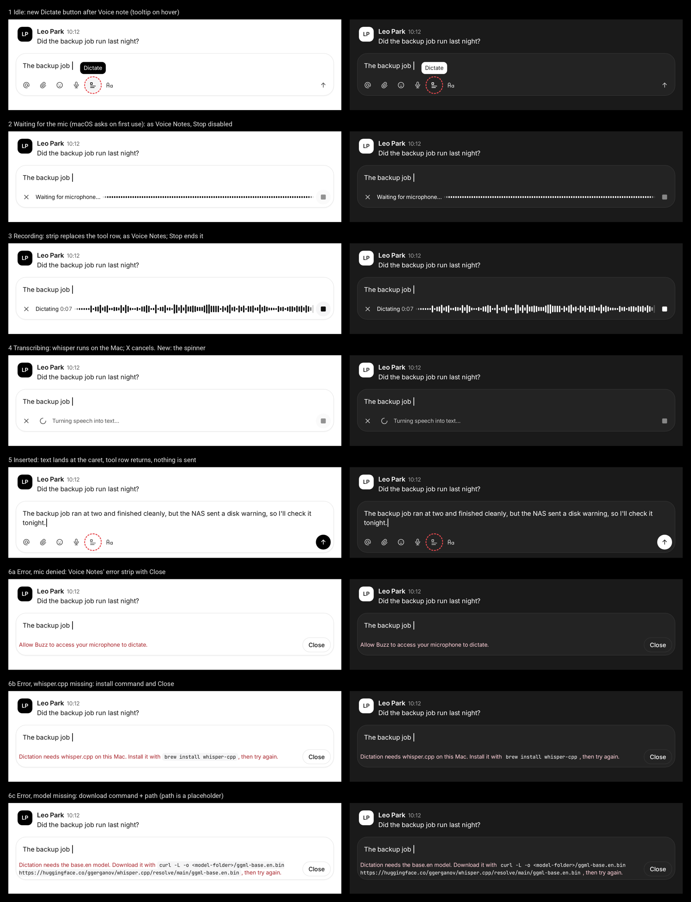

# Voice Input

Dictate into the Buzz composer. Choose **Dictate** (after the Voice note mic),
talk, then choose **Stop**. [whisper.cpp](https://github.com/ggml-org/whisper.cpp)
turns your speech into text on this Mac, and the text goes into the composer
at the caret for you to check. Nothing is sent until you send it.

- English only, with the `base.en` model (`small.en` if that is the one you have).
- A recording stops at 5:00, the same as a voice note.
- **X** discards the recording, or stops transcribing it.

## Getting started

1. Install whisper.cpp:

   ```sh
   brew install whisper-cpp
   ```

2. Download the model to the one place the plugin reads it from, then check it:

   ```sh
   curl -L --create-dirs -o ~/.local/share/whisper/ggml-base.en.bin \
     https://huggingface.co/ggerganov/whisper.cpp/resolve/5359861c739e955e79d9a303bcbc70fb988958b1/ggml-base.en.bin
   shasum -a 256 ~/.local/share/whisper/ggml-base.en.bin
   # a03779c86df3323075f5e796cb2ce5029f00ec8869eee3fdfb897afe36c6d002
   ```

   If `base.en` gets too many words wrong, use `small.en` instead (465 MB,
   slower). Remove `ggml-base.en.bin`, because the plugin prefers it:

   ```sh
   curl -L -o ~/.local/share/whisper/ggml-small.en.bin \
     https://huggingface.co/ggerganov/whisper.cpp/resolve/5359861c739e955e79d9a303bcbc70fb988958b1/ggml-small.en.bin
   shasum -a 256 ~/.local/share/whisper/ggml-small.en.bin
   # c6138d6d58ecc8322097e0f987c32f1be8bb0a18532a3f88f734d1bbf9c41e5d
   ```

3. Install the plugin (below), then choose **Dictate** in any composer. The
   first time, macOS asks to let Buzz use the microphone.

The plugin downloads nothing itself. If whisper.cpp or the model is missing,
the composer says so and shows the command for it.

---

## Install

Open the install link. Buzz opens **Settings → Plugins → Add** with this
folder picked from Git:

```sh
open 'buzz://plugin-install?repository=man15h%2Fbuzz-plugins&path=plugins%2Fvoice-input'
```

Review the access it asks for (one process, below) and install it.

Or install from a clone: **Settings → Plugins → Manage plugins → Add**, then
**Browse** under Add from folder, and pick the clone's `plugins/voice-input/`
folder.

## What it can reach

The manifest declares one process and nothing else: no network origins, no
commands, no file access. That process is macOS `sandbox-exec` with a fixed
profile, running a fixed `/bin/sh` line. The plugin passes it no arguments, so
what you review at install is all it runs.

The profile starts from `(deny default)`: everything is refused unless a rule
below allows it. That covers network, IPC with system services (Mach
lookups, so no clipboard and no asking a daemon to fetch something), and every
file not listed. Every allow:

| Rule | What it lets through | Why |
|---|---|---|
| `process-fork` | Starting a child process | `sh` runs `base64` and whisper-cli as a pipe |
| `process-exec` | Only `/bin/sh` (and the `/bin/bash` or `/bin/dash` it hands off to), `/usr/bin/base64`, and whisper-cli at `/opt/homebrew/bin` or `/usr/local/bin` and in their `Cellar/whisper.cpp` (or the formula's old name, `Cellar/whisper-cpp`) | The three programs in the pipe |
| `sysctl-read` | Reading kernel settings such as the CPU count | whisper picks its thread count from it |
| `file-read-metadata` | `stat` on any path: whether it exists, size and dates. Not its contents, and not a directory's listing | Loading libraries walks paths; listing every parent folder would be brittle |
| `file-read*` on `/System/Library`, `/System/Cryptexes`, `/System/Volumes/Preboot/Cryptexes`, `/usr/lib`, `/usr/share`, `/bin`, `/usr/bin`, `/private/var/select` | macOS's own libraries, programs and shared data | Every program needs the system libraries; `/private/var/select` says which shell `/bin/sh` is |
| `file-read*` on `/opt/homebrew`, `/usr/local` | Homebrew's programs and libraries | whisper-cli and the ggml libraries it loads |
| `file-read*` on `/dev/null`, `/dev/urandom` | Those two devices | Standard library start-up |
| `file-read*` on `~/.local/share/whisper/ggml-base.en.bin` or `ggml-small.en.bin` | The model, and nothing else under `/Users` | The model |
| `file-write-data` on `/dev/null` | Writes to `/dev/null` only | Discarded output |

Nothing else is allowed, so whisper-cli has no network, cannot read your files
or other apps' caches, and writes no files. It runs on the CPU (`-ng`). With
the GPU, Metal would need its own system services and a writable cache
folder, and the profile would have to open both. `base.en` on Apple silicon
transcribes a five-minute clip in seconds without the GPU.

The recording reaches it on stdin as base64 (plugin processes take text), and
`base64 -D` decodes it inside the sandbox. The text comes back on stdout.

### A second layer: LuLu

With [LuLu](https://objective-see.org/products/lulu.html), add a rule for
`/opt/homebrew/bin/whisper-cli` (or the path `which whisper-cli` prints) that
**blocks** all outbound connections. Dictation keeps working, since whisper-cli
never needs the network after the model is on disk.

## When it does not work

The composer shows one of these:

| It says | What to do |
|---|---|
| Allow Buzz to access your microphone | System Settings → Privacy & Security → Microphone, turn on Buzz |
| Dictation needs whisper.cpp | `brew install whisper-cpp` |
| Dictation needs the base.en model | Step 2 above |
| No speech was heard | Try again, closer to the mic |
| Buzz could not turn this into text | Run the same thing in Terminal, below |

The last one usually means the sandbox blocked something whisper-cli needed.
To see what, run the process by hand on a WAV file, then look for `deny` lines
in the sandbox log:

```sh
base64 -i some.wav | sandbox-exec -p "$(jq -r '.host.processes[0].args[1]' manifest.json)" \
  /bin/sh -c "$(jq -r '.host.processes[0].args[4]' manifest.json)"
log show --last 2m --predicate 'sender == "Sandbox"' | grep whisper
```

## Mockups

Design sheets, in [`mockups/`](mockups/). The dashed ring marks the new button
and is not part of the design.



## Limits

- macOS only (`sandbox-exec` and Homebrew).
- English only.
- The text goes in exactly as whisper.cpp wrote it. Check it before you send.
